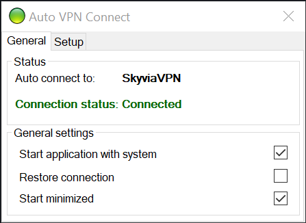
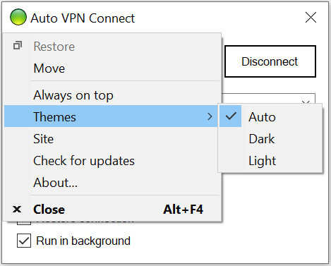
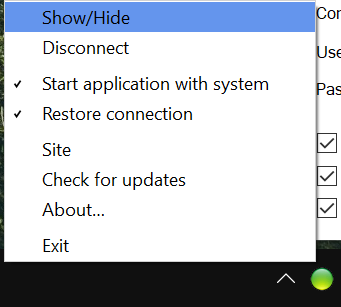

# Auto VPN Connect

AutoVPNConnect - is free software that can auto reconnect your VPN if it was disconnected.

----

## Features

### What can it do?

 - Shows the state of the VPN connection (Connected / Disconnected / Busy) and connects or disconnects it with one button.
 - Reconnects automatically when the VPN is lost: the connection is restored when the network configuration changes (the `Restore connection` option).
 - Reconnects with the saved user/password (the Windows RAS API is used, `rasdial` as a fallback).
 - Reconnects without the saved user/password: the credentials stored in the Windows VPN connection are used, and if there are none, the standard VPN connection dialog (`rasphone`) is displayed.
 - Recovers from the Windows error 633 ("port already in use"): the leftovers of previous dials are hung up and the dial is repeated. As the last resort the Remote Access Connection Manager service (`RasMan`) is restarted (the UAC prompt appears, no more than once in 10 minutes).
 - Runs as a background application with a tray icon. The colour of the icon shows the state: green - connected, red - disconnected, yellow - busy.
 - Can start with Windows (`Start application with system`) and start hidden in the tray (`Run in background`, closing the window then only hides it).
 - Checks for updates and opens the project site from the app.
 - No installation required, just save the executable file anywhere on your computer and run it.

### How to use it

1. Connect to your VPN the usual way, then start the app and choose the connection in the `Connection` list (the list contains the VPN connections that are active now; if there are none, the app offers to open the Windows network connections).
2. Enter the user name and password if the VPN connection has no saved credentials, then press `Save`.
3. Switch on `Restore connection` to reconnect automatically, `Start application with system` and `Run in background` if the app should work unattended.

The password is not stored as a plain text, but it is encoded with a key built into the app, so this only protects it from a casual look. Use the credentials of the Windows VPN connection if this is not acceptable.

### Tray and system menu

 - Tray menu: Show/Hide, Connect/Disconnect, Start with system, Restore connection, Site, Check for updates, About, Exit. A double click on the tray icon shows or hides the window.
 - The system menu of the window (click on the icon of the title) has the extra items: Always on top, Site, Check for updates, About.
 - The window snaps to the edges of the screen.
 - Only one instance of the app can run at the same time.

### Requirements

 - Windows with .NET Framework 4.7.2 or newer.
 - A VPN connection that is created in Windows (PPP/RAS based: PPTP, L2TP, SSTP, IKEv2).

### UI example 

Main app window:

Extended app system menu:

System tray integration with menu:

## Download

The published version can be obtained from [releases](https://github.com/sergiye/AutoVPNConnect/releases).

## How can I help improve it?
The AutoVPNConnect team welcomes feedback and contributions! 
You can check if it works properly on your PC. If you notice any inaccuracies, please send us a pull request. 
If you have any suggestions or improvements, don't hesitate to create an issue.

Also, don't forget to star the repository to help other people find it.

## Donate!
Every [cup of coffee](https://patreon.com/SergiyE) you donate will help this app become better and let me know that this project is in demand.

## License

This program is free to use for **personal, home and other non-commercial purposes only**.

Any commercial use is not allowed without prior written permission from the author. This includes use inside a company or organization, bundling it with or into commercial products or services, and selling it or charging for access to it. For commercial licensing, please contact the author through [GitHub issues](https://github.com/sergiye/AutoVPNConnect/issues).

You may share unmodified copies of the program free of charge, as long as they are used under the same terms.

This program is distributed in the hope that it will be useful, but WITHOUT ANY WARRANTY; without even the implied warranty of MERCHANTABILITY or FITNESS FOR A PARTICULAR PURPOSE.
